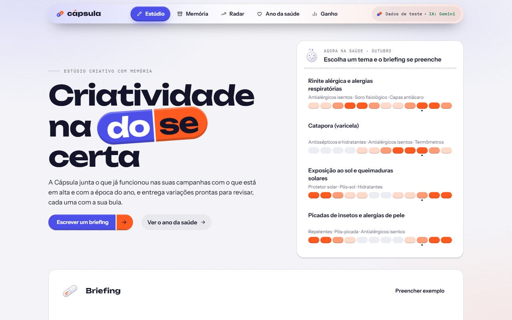

# Cápsula

**Estúdio criativo com memória para o marketing** · *Criatividade na dose certa*

[](https://capsula-mvp.vercel.app)
[](#qualidade)
[](https://nextjs.org)
[](https://www.typescriptlang.org)
[](https://ai.google.dev)
[](https://vercel.com)

A Cápsula transforma um briefing de campanha em peças prontas para revisão nos formatos feed, story e banner. Antes de escrever, ela consulta o que já funcionou nas campanhas anteriores, o que está em alta e a época do ano na saúde. Cada peça sai com uma **Bula**, que mostra de onde veio cada ideia, e passa por um checklist das regras da Anvisa antes de chegar a uma pessoa, que é quem aprova.

> **Projeto do Hackathon Avanade · Desafio 1, Creative AI.** Entrega em 26/10/2026, por um time de três pessoas (o time começou com cinco).
> **Confidencial:** o enunciado do desafio não é publicado e a empresa cliente não é identificada. Todos os dados do protótipo são de teste ou de fontes públicas, e a marca das peças é fictícia ("Farmácia Exemplo").

**Teste agora:** https://capsula-mvp.vercel.app (clique em "Preencher exemplo" e em "Gerar variações")



## Sumário

- [O problema](#o-problema)
- [A solução](#a-solução)
- [O que já funciona](#o-que-já-funciona)
- [Como funciona por dentro](#como-funciona-por-dentro)
- [Stack](#stack)
- [Como rodar localmente](#como-rodar-localmente)
- [Qualidade](#qualidade)
- [Documentação](#documentação)
- [Limitações conhecidas](#limitações-conhecidas)
- [Time e processo](#time-e-processo)
- [Uso de IA generativa](#uso-de-ia-generativa)
- [Dados e confidencialidade](#dados-e-confidencialidade)

## O problema

O time de marketing da rede recebe uma oferta, como um protetor solar com desconto, e precisa transformá-la em peças para três formatos e três públicos. São **nove peças para uma ideia só**, e amanhã chega outra. Hoje esse trabalho passa por planilhas, agência e ferramentas de IA genéricas, que têm dois problemas:

1. **Não lembram o que funcionou.** O que deu certo na campanha passada fica na cabeça de alguém.
2. **Não conhecem as regras da farmácia.** Publicidade de medicamento tem regra (RDC 96/2008 da Anvisa), e toda peça precisa de revisão.

## A solução

Um aplicativo web para analistas de marketing, designers e gestores de marca. A pessoa informa produto, preços e públicos e clica em gerar:

| Passo | O que acontece |
|---|---|
| 1. **Briefing** | Produto, tipo de produto, preço normal e da oferta (o desconto é calculado sozinho), públicos, canais e objetivo |
| 2. **Memória** | O sistema busca no histórico as combinações de gancho, tom, formato e público que renderam acima e abaixo da média |
| 3. **Radar e Ano da saúde** | Junta o que está em alta (formatos, hashtags, músicas liberadas) e as condições de saúde em pico no mês, sempre com fonte e data |
| 4. **Geração** | O modelo de linguagem (Gemini) escreve as peças em cima dessas evidências, uma técnica chamada RAG |
| 5. **Governança** | O checklist bloqueia o que não pode sair (promessa de cura, remédio com receita, oferta sem validade) e explica o motivo |
| 6. **Aprovação** | Uma pessoa leva cada peça de rascunho a revisão, aprovado e publicado. Nada vai ao ar sem ela |
| 7. **Aprendizado** | A peça publicada volta para a Memória e orienta a próxima geração |

O nome vem da **dose**: cada peça mostra quanto veio do que já funcionou (memória) e quanto veio do que está em alta (tendência). A metade anil da marca é a memória, e a metade brasa é a tendência.

## O que já funciona

Tudo abaixo está no ar em https://capsula-mvp.vercel.app e foi conferido em produção ([QA em produção](docs/qa-producao.md)).

| Tela | O que faz |
|---|---|
| **Estúdio** (`/`) | Briefing com exemplo pronto, desconto automático, até 4 públicos e geração de 3 variações por canal e público. Sugere temas da época ("Agora na saúde") que preenchem o briefing |
| **Galeria** | Peças em feed 1:1, story 9:16 e banner 16:9 com o manual da marca fictícia, filtros por público e canal e download em PNG no tamanho real (1080×1080, 1080×1920 e 1920×1080) |
| **Bula** | Indicação, composição, dose (memória × tendência), evidências com fonte e data, contraindicações (resultado do checklist) e posologia |
| **Aprovação** | Quatro estados (rascunho, em revisão, aprovado, publicado), com o nome de quem mudou e o histórico. Peça bloqueada não avança, e o servidor confere de novo a cada mudança |
| **Roteiros** | Reels ou TikTok de 15 s e comercial de 15 s e 30 s, cena a cena, com gancho nos 3 primeiros segundos e música liberada para uso comercial |
| **Memória** (`/memoria`) | 300 campanhas de teste, filtros por canal e público e as combinações que renderam mais e menos, com explicação |
| **Radar** (`/radar`) | Tendências e sazonalidade de saúde com fonte, data e validade |
| **Ano da saúde** (`/saude`) | 33 condições com intensidade por mês, filtros por tema, causa e região e ficha com produtos da farmácia |
| **Painel de ganho** (`/ganho`) | Mede tempo de geração, variações e peças barradas e compara com o processo de hoje por premissas declaradas e editáveis |
| **Design system** (`/design-system`) | Os componentes da Cápsula e a linguagem das formas farmacêuticas |

Funciona no computador e no celular, sem rolagem horizontal de 360 a 1280 px. O passo a passo com telas está no [Guia de uso](docs/guia-de-uso.md).

## Como funciona por dentro

```
 Navegador (Next.js · React)                       Servidor (rotas de API na Vercel)
 ─────────────────────────────                     ─────────────────────────────────────────────
 Estúdio ── briefing ──► POST /api/gerar ──► valida (Zod) ──► cache? ──► motor
                                                                          │
                       CampaignDataSource (mock | csv) ──► contexto ◄─────┤ memória (ranking)
                                                                          │ radar + Ano da saúde
                                                                          ▼
                                                     prompt ──► Gemini (principal + reservas)
                                                                          │   └─ falhou? moldes fixos
                                                                          ▼
                                       montagem: fonte das evidências pelo sistema, dose, ids limpos
                                                                          ▼
                                                     governança: checklist RDC 96/2008 e marca
 Galeria + Bula ◄──────────────────────────────────── variações + roteiros + avisos
 Aprovação ── POST /api/pecas/status ──► refaz o checklist ──► transição válida?
 Memória ── GET /api/memoria/ranking        Radar ── GET /api/radar        Ganho ── navegador
```

Detalhes em [Arquitetura](docs/arquitetura.md), [Motor criativo](docs/motor.md) e [API](docs/api.md).

## Stack

| Camada | Escolha | Por quê |
|---|---|---|
| Aplicação | **Next.js 16** (App Router) + **React 19** + **TypeScript** | Tela e API num projeto só, com deploy direto |
| Contratos | **Zod 4** | A mesma validação roda no navegador e no servidor |
| IA | **Gemini** (`gemini-3.5-flash-lite`, com `gemini-3.5-flash` e `gemini-3.1-flash-lite` de reserva) | Camada gratuita e resposta em 6 a 15 s nos testes em produção |
| Peças | Templates HTML/CSS + `html-to-image` | PNG no tamanho real, sem imagem inventada por IA |
| Dados | Adaptador `CampaignDataSource` (dados de teste ou CSV) | Trocar a fonte não muda tela nem motor |
| Testes | **Vitest** | 98 testes em 13 arquivos |
| Deploy | **Vercel** | Publicação automática a cada merge na `main` |

## Como rodar localmente

Requisitos: Node.js 20 ou mais recente e npm.

```bash
git clone https://github.com/joaobatis1a/capsula.git
cd capsula
npm install
cp .env.example .env.local   # opcional: coloque a GEMINI_API_KEY
npm run dev                  # http://localhost:3000
```

Sem chave, a Cápsula gera pelos **moldes fixos** ("modo sem IA") e avisa na tela. Com a `GEMINI_API_KEY`, gera com o modelo.

| Comando | O que faz |
|---|---|
| `npm run dev` | Servidor de desenvolvimento |
| `npm test` | Os 98 testes automatizados |
| `npm run lint` | ESLint |
| `npx tsc --noEmit` | Checagem de tipos |
| `npm run build` | Build de produção |

| Variável | Para quê | Padrão |
|---|---|---|
| `GEMINI_API_KEY` | Chave do Gemini | vazia (modo sem IA) |
| `GEMINI_MODEL` | Modelo principal | `gemini-3.5-flash-lite` |
| `GEMINI_FALLBACK_MODELS` | Reservas, na ordem | `gemini-3.5-flash,gemini-3.1-flash-lite` |
| `DATA_SOURCE` | `mock` (dados de teste) ou `csv` | `mock` |
| `CSV_CAMPANHAS`, `CSV_MAPPING` | Arquivo de campanhas e o mapa das colunas, com `DATA_SOURCE=csv` | exemplos em `mocks/` |

Chaves ficam só no `.env.local` (fora do Git) e nas variáveis da Vercel. Para ligar os dados da empresa, veja [Dados reais](docs/dados-reais.md).

## Qualidade

- **98 testes automatizados** cobrindo contratos, adaptador de dados (mock e CSV com a mesma suíte), ranking da Memória, motor, troca de modelo, governança, fluxo de aprovação, roteiros, oferta, painel de ganho e Ano da saúde. Resumo em [Qualidade e testes](docs/qualidade.md).
- **QA do motor com 10 briefings** em produção, um por tipo de produto, incluindo os casos que precisam ser bloqueados ([qa-motor.md](docs/qa-motor.md)).
- **QA em produção** do fluxo completo, por API e em tela, no computador e no celular ([qa-producao.md](docs/qa-producao.md)).
- Cada mudança entrou por Pull Request, e cada merge na `main` publicou sozinho na Vercel.

## Documentação

O índice completo está em [`docs/README.md`](docs/README.md).

| Para | Leia |
|---|---|
| Entender o produto | [Visão do produto](docs/visao-produto.md) · [Guia de uso](docs/guia-de-uso.md) · [Manual de marca](docs/manual-de-marca.md) |
| Entender o código | [Arquitetura](docs/arquitetura.md) · [Motor criativo](docs/motor.md) · [API](docs/api.md) · [Dados reais](docs/dados-reais.md) |
| Conferir a qualidade | [Qualidade e testes](docs/qualidade.md) · [QA do motor](docs/qa-motor.md) · [QA em produção](docs/qa-producao.md) · [Ano da saúde](docs/ano-da-saude-verificacao.md) |
| Ver o processo | [Definition of Done](docs/definition-of-done.md) · [Sprints](docs/sprints/) · [Uso de IA](docs/uso-de-ia.md) |
| Próximos passos | [Limitações e próximos passos](docs/limitacoes-e-proximos-passos.md) |
| O pitch | [Roteiro de falas e cobertura da rubrica](docs/pitch-roteiro-de-falas.md) · [Vídeo do pitch gravado (4:27)](https://drive.google.com/file/d/1AvHGMe0L-eU0a4wTjmnpy4tsK1Twsqg5/view?usp=drive_link) |

## Limitações conhecidas

Ditas com a mesma clareza no pitch e na tela:

- **Dados de teste.** O histórico de 300 campanhas é sintético, e os padrões que o ranking encontra foram plantados para provar que ele funciona. A tela marca tudo como "dados de teste".
- **Regras mínimas.** O checklist cobre o essencial da RDC 96/2008 e do CONAR, mas **não é parecer jurídico** e precisa de revisão jurídica antes de uso real.
- **Ano da saúde aproximado.** 5 das 33 condições foram conferidas com fonte pública; as outras são aproximações ([conferência](docs/ano-da-saude-verificacao.md)).
- **Radar ilustrativo.** Os itens de tendência são exemplos com fonte e data; a coleta automática é a próxima fase.
- **Sem banco.** A aprovação vive na sessão do navegador; persistência e permissões por papel vêm depois.
- **IA em plano gratuito.** O Gemini pode responder com cota esgotada; o motor troca de modelo e, no limite, usa os moldes fixos, sempre com aviso.

O plano para cada uma está em [Limitações e próximos passos](docs/limitacoes-e-proximos-passos.md).

## Time e processo

| Pessoa | Papel no Scrum | GitHub |
|---|---|---|
| João Batista | Product Owner e Developer | [@joaobatis1a](https://github.com/joaobatis1a) |
| Hector | Scrum Master e Developer | [@Hector-Borges](https://github.com/Hector-Borges) |
| Ivaldo | Developer | [@IvaldoMonteiro](https://github.com/IvaldoMonteiro) |

- **Formação do time:** o time começou com cinco pessoas e terminou com três, porque uma desistiu e outra não foi possível contatar nos primeiros dias. O acompanhamento da mentoria desde o começo foi essencial para o time se organizar e chegar à entrega.
- **Duas sprints:** Sprint 1 de 15 a 20/10 (app, motor e interface) e Sprint 2 de 21 a 25/10 (governança, integração, QA e pitch), com Planning, Review e Retrospective registrados em [`docs/sprints/`](docs/sprints/).
- **Backlog no GitHub:** 45 issues com critérios de aceitação, 42 fechadas com evidência; as 3 abertas (Radar real e conferência completa do Ano da saúde) são a próxima fase ([quadro](https://github.com/users/joaobatis1a/projects/1)).
- **Fluxo de Git:** ninguém commita na `main`; tudo entra por Pull Request com Squash and merge, no padrão `tipo(escopo): descrição`.
- **Definition of Done** em cinco blocos: código, funcionamento, interface, dados e registro ([DoD](docs/definition-of-done.md)).
- **Contribuições:** o escopo foi dividido entre os três em 15/10. Quem entregou cada parte, com a evidência no repositório, está em [Contribuições por integrante](docs/contribuicoes.md).

## Uso de IA generativa

A IA aparece em dois lugares, e os dois estão registrados:

1. **No produto:** o Gemini escreve as peças e os roteiros. O sistema, e não o modelo, escreve a fonte de cada evidência, calcula a dose, roda o checklist e exige uma pessoa para aprovar.
2. **No desenvolvimento:** o time usou o Claude (Anthropic) para escrever código, testes e documentação, sempre por Pull Request revisado. O registro por missão e por sprint, com o que a IA fez e o que o time corrigiu ou rejeitou, está em [Uso de IA generativa](docs/uso-de-ia.md).

## Dados e confidencialidade

- Nenhum dado real da empresa cliente é usado: tudo é sintético ou público, com a origem marcada na tela.
- A marca das peças é fictícia ("Farmácia Exemplo"), definida em `lib/marca/marca.json`.
- Nenhuma chave entra em commit; o repositório é privado e de acesso restrito ao time e aos avaliadores.
