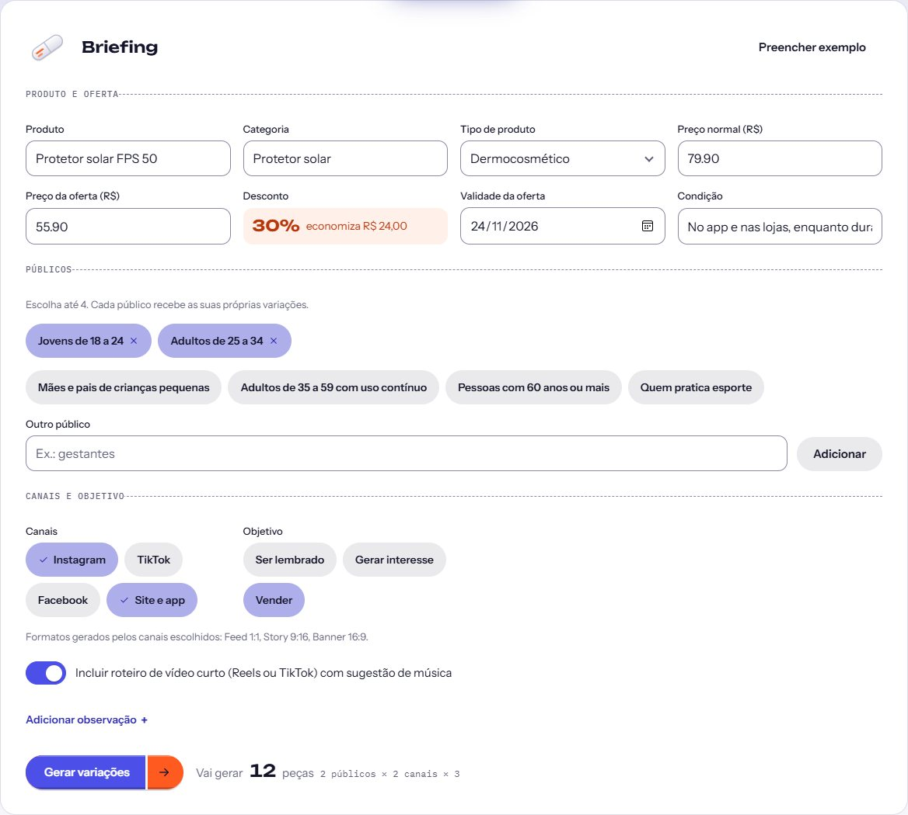
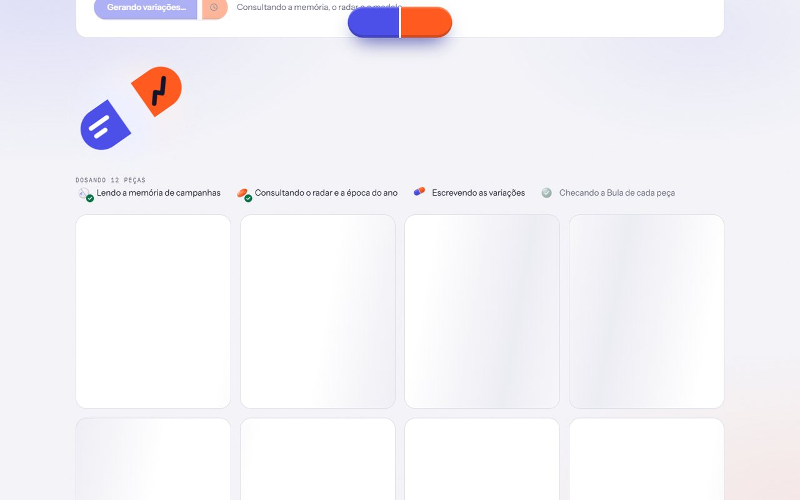
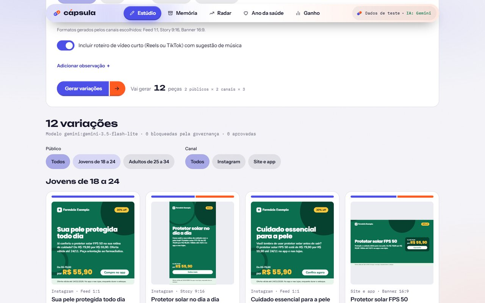
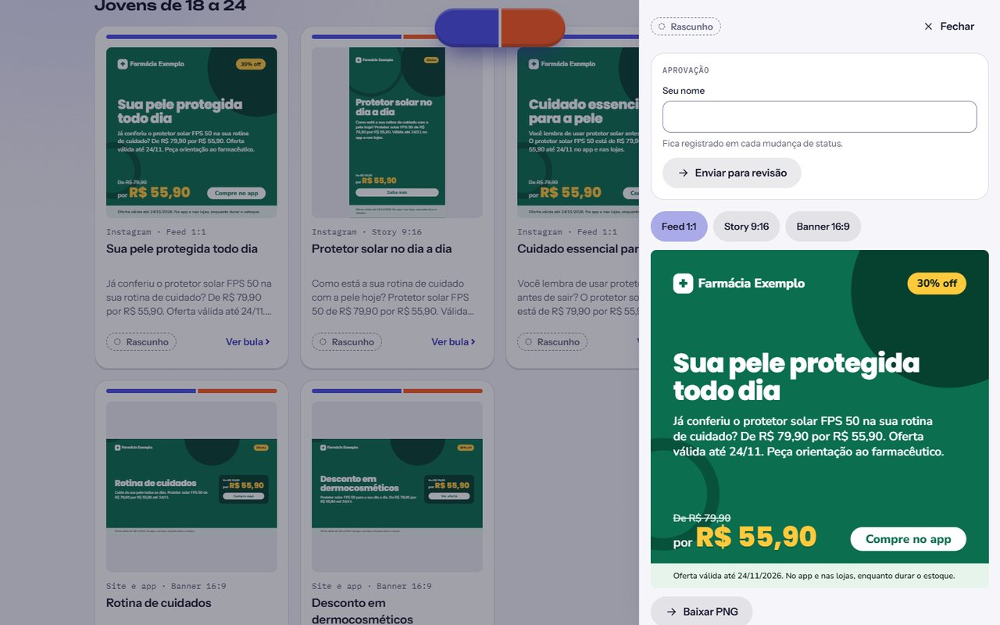
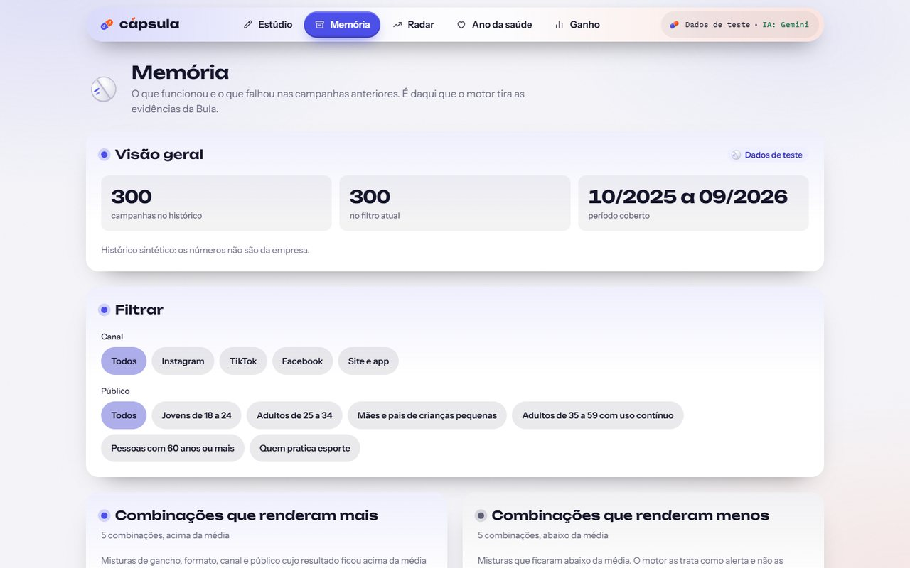
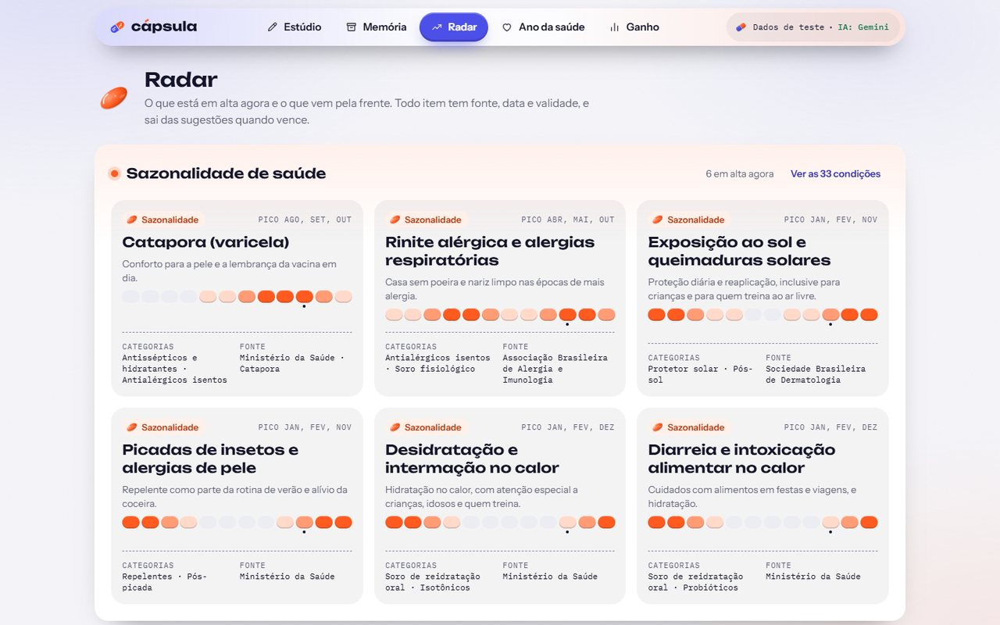
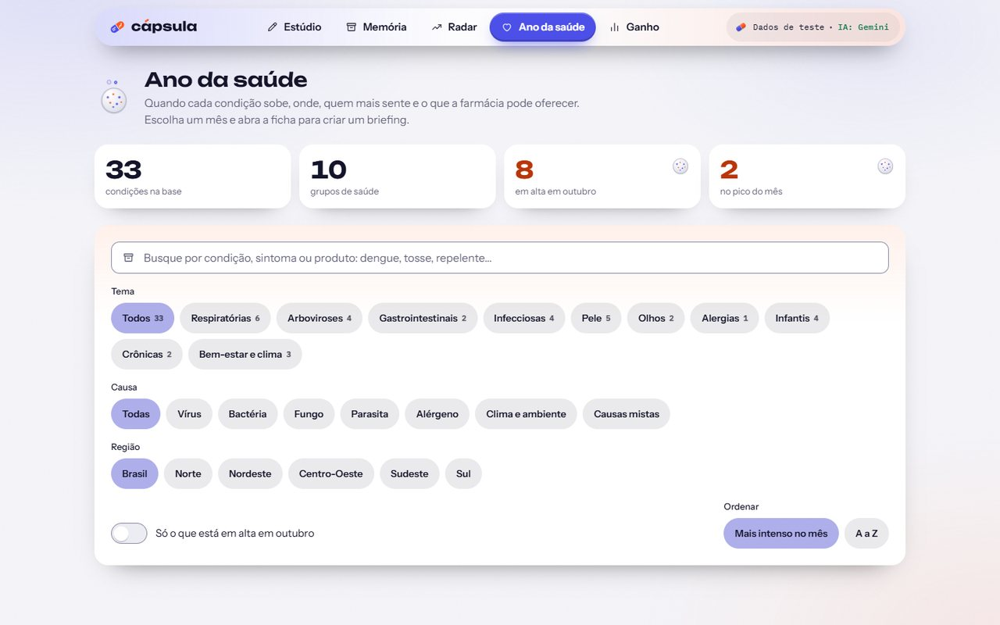
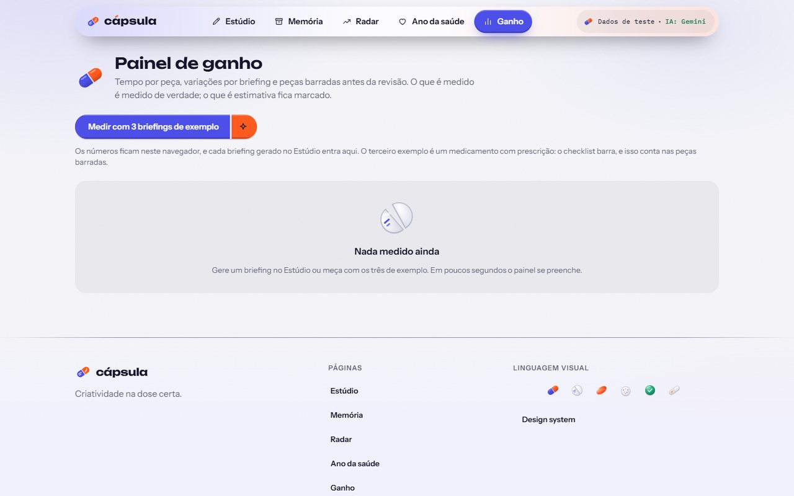
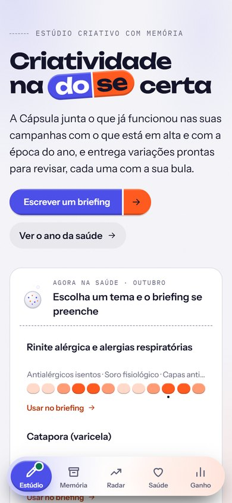

# Guia de uso

**Para quem:** analistas de marketing, designers e gestores de marca que vão usar a Cápsula, e para a banca que vai testá-la.
**Onde:** https://capsula-mvp.vercel.app, no computador ou no celular. Não precisa de login.
**Atualizado em:** 25/10/2026, com telas capturadas em produção.

> Tudo o que aparece no protótipo é **dado de teste** ou de **fonte pública**, e a marca das peças é fictícia ("Farmácia Exemplo"). O selo "Dados de teste · IA: Gemini" no canto do cabeçalho diz de onde vêm os dados e qual IA está respondendo.

## Sumário

1. [Em dois minutos](#1-em-dois-minutos)
2. [Escrever o briefing](#2-escrever-o-briefing)
3. [Gerar as variações](#3-gerar-as-variações)
4. [Ler a galeria](#4-ler-a-galeria)
5. [Abrir a Bula](#5-abrir-a-bula)
6. [Aprovar uma peça](#6-aprovar-uma-peça)
7. [Usar os roteiros de vídeo](#7-usar-os-roteiros-de-vídeo)
8. [Memória](#8-memória)
9. [Radar](#9-radar)
10. [Ano da saúde](#10-ano-da-saúde)
11. [Painel de ganho](#11-painel-de-ganho)
12. [No celular](#12-no-celular)
13. [Quando algo dá errado](#13-quando-algo-dá-errado)
14. [Glossário](#14-glossário)

## 1. Em dois minutos

1. Abra https://capsula-mvp.vercel.app.
2. No quadro **Briefing**, clique em **Preencher exemplo**.
3. Clique em **Gerar variações** e espere uns 10 segundos.
4. Na galeria, clique em **Ver bula** em qualquer peça.
5. Para ver o bloqueio: troque o **Tipo de produto** para "Medicamento com prescrição" e gere de novo. Todas as peças saem **bloqueadas**, com o motivo na Bula.

## 2. Escrever o briefing

O briefing é o pedido. Ele fica logo abaixo da abertura do Estúdio.

| Campo | O que pôr | Observação |
|---|---|---|
| **Produto** | O nome do produto, como "Protetor solar FPS 50" | Obrigatório |
| **Categoria** | A categoria da loja, como "Dermocosméticos" | Obrigatório |
| **Tipo de produto** | Medicamento isento, medicamento com prescrição, dermocosmético, higiene e beleza, suplemento, infantil ou serviço | **Decide as regras do checklist.** Medicamento com prescrição não pode ter propaganda para o público |
| **Preço normal** e **Preço da oferta** | Em reais, como 79,90 e 55,90 | O **desconto** aparece sozinho ("30%, economiza R$ 24,00"). O preço da oferta precisa ser menor que o normal |
| **Validade da oferta** | Até quando vale | Toda peça com preço traz a validade, por regra |
| **Condição** | Onde e como vale ("no app e nas lojas, enquanto durar o estoque") | Opcional; já vem com um texto padrão |
| **Públicos** | Até 4. Há sugestões (jovens de 18 a 24, 60 anos ou mais...) e "Outro público" para escrever | Cada público recebe as suas próprias variações |
| **Canais** | Instagram, TikTok, Facebook, Site e app | **Os formatos vêm dos canais:** Instagram e Facebook dão feed e story, TikTok dá story, Site e app dá banner |
| **Objetivo** | Ser lembrado, Gerar interesse ou Vender | Muda o tom e o chamado para ação |
| **Roteiro de vídeo** | Liga os roteiros de Reels ou TikTok e de comercial | Opcional |
| **Observação** | Algo que a IA deve considerar | Opcional, fica recolhida em "Adicionar observação" |

Abaixo do botão, a Cápsula mostra quantas peças vai gerar: por exemplo, **12 peças = 2 públicos × 2 canais × 3 variações**.

**Atalho pela época do ano.** No topo do Estúdio, o quadro **Agora na saúde** mostra as condições em alta no mês (rinite, catapora, exposição ao sol...). Clicar em **Usar no briefing** preenche o briefing com o tema e os produtos ligados a ele.

Se faltar algo, o campo fica marcado e a mensagem diz o que corrigir ("Informe o produto.").

## 3. Gerar as variações

Ao clicar em **Gerar variações**, a tela de dosagem mostra as quatro etapas: ler a memória de campanhas, consultar o radar e a época do ano, escrever as variações e checar a Bula de cada peça.

Leva **de 6 a 15 segundos** na maioria dos casos. O mesmo briefing pedido de novo volta do cache em menos de 1 segundo, sem gastar cota da IA.

## 4. Ler a galeria

- **Resumo no topo:** quantas variações saíram, **qual modelo respondeu**, quantas foram bloqueadas pela governança e quantas já foram aprovadas.
- **Filtros** por público e por canal.
- **Cada cartão** mostra a peça pronta, o canal e o formato, o título, o texto e o estado (Rascunho, Bloqueado...).
- As peças seguem o **manual da marca fictícia** ([manual-de-marca.md](manual-de-marca.md)): cores, tipografia, selo de oferta, faixa legal com a validade e, em medicamento isento, a advertência da Anvisa.

## 5. Abrir a Bula

Clique em **Ver bula** num cartão. O painel lateral abre com a peça, a aprovação e a Bula.

| Seção | O que diz |
|---|---|
| **Formatos** | Feed 1:1, Story 9:16 e Banner 16:9 da mesma peça, com **Baixar PNG** no tamanho real |
| **Dose** | Quanto da peça veio da **memória** (o que já funcionou) e quanto da **tendência** (o que está em alta e a época do ano) |
| **Indicação** | Para quem é a peça e por quê |
| **Composição** | Gancho, tom e benefício escolhidos |
| **Evidências** | De onde veio cada ideia, **com fonte e data**: "9 campanhas · 11/2025 a 09/2026 · nos dados de teste" ou "TikTok Creative Center · 12/10". A fonte é escrita pelo sistema, não pela IA |
| **Contraindicações** | O resultado de cada regra do checklist: sem termos proibidos, sem promessa de resultado, sem diagnóstico, sem alegação terapêutica indevida, sem superlativo, dentro do tom da marca, oferta com validade |
| **Posologia** | Quando e onde publicar |

Se uma regra falhar, a peça fica **Bloqueada** e a contraindicação mostra o motivo, como "Medicamento com prescrição não pode ter propaganda para o público em geral (RDC 96/2008)".

## 6. Aprovar uma peça

No topo da Bula fica o quadro **Aprovação**.

1. Escreva **seu nome**. Ele fica registrado em cada mudança.
2. **Enviar para revisão** → **Aprovar** → **Publicar**.
3. Para voltar uma peça, use **Devolver** e diga o motivo.

| Regra | Por quê |
|---|---|
| Não dá para aprovar direto do rascunho nem publicar sem aprovar | A revisão humana é obrigatória |
| Sem nome, a mudança é recusada | Toda decisão tem responsável |
| Peça bloqueada não avança | O servidor refaz o checklist a cada mudança, mesmo que a tela diga outra coisa |

A peça aprovada ganha o carimbo **Aprovado** ou **Publicado**, e o histórico lista quem mudou e quando. A peça publicada aparece na **Memória**, em "Publicadas pelo Estúdio".

## 7. Usar os roteiros de vídeo

Com o roteiro ligado no briefing, a galeria traz, para cada público:

- **Reels ou TikTok de 15 s**, cena a cena;
- **Comercial de 15 s e de 30 s**.

Cada cena tem tempo, **visual**, **fala** e **texto na tela**. A primeira cena é o **gancho** e termina até os 3 segundos. O roteiro sugere uma **música liberada para uso comercial** do Radar e mostra de onde veio ("Veio de: ..."). Os roteiros passam pelo mesmo checklist das peças.

## 8. Memória

A Memória é o histórico de onde o motor tira as evidências.

- **Visão geral:** 300 campanhas de teste, de 10/2025 a 09/2026.
- **Filtros** por canal e por público.
- **Combinações que renderam mais** e **que renderam menos**: misturas de gancho, tom, formato, canal e público que ficaram acima ou abaixo da média. **Ver mais detalhes** explica o número e quantas campanhas sustentam cada uma.
- **Publicadas pelo Estúdio:** as peças que você aprovou e publicou nesta sessão.

## 9. Radar

O que está em alta agora e o que vem pela frente. Cada item tem **fonte, data e validade** e sai das sugestões quando vence.

- **Sazonalidade de saúde:** as condições em pico no mês e nos dois seguintes, com categorias de produto e fonte.
- **Tendências:** formatos, hashtags, músicas (marcadas como liberadas ou não para uso comercial) e datas do calendário.

## 10. Ano da saúde

Quando cada condição sobe, onde, quem mais sente e o que a farmácia pode oferecer.

- **33 condições** em 10 grupos, com a intensidade de cada mês (fora de época, baixo, médio, pico).
- **Busca** por condição, sintoma ou produto ("dengue", "tosse", "repelente").
- **Filtros** por tema, causa e região, e "Só o que está em alta" no mês atual.
- A **ficha** de cada condição traz sintomas, cuidados, produtos e fonte, e o botão **Criar briefing com este tema**, que leva ao Estúdio com o briefing preenchido.

As intensidades são **aproximadas**, a partir de fontes públicas ([conferência](ano-da-saude-verificacao.md)).

## 11. Painel de ganho

Mostra o que a Cápsula mede de verdade e como isso se compara ao processo de hoje.

- **Medido:** tempo de geração, variações por briefing e peças barradas pelo checklist, a cada geração feita no Estúdio.
- **Comparação:** usa **premissas declaradas e editáveis** (hoje, 40 minutos por peça e 3 peças por briefing; na Cápsula, 3 minutos de revisão por variação). Não são dados da empresa.
- **Medir com 3 briefings de exemplo** preenche o painel em poucos segundos. O terceiro exemplo é um medicamento com prescrição, para mostrar o checklist barrando.

Os números ficam guardados neste navegador.

## 12. No celular

No celular, o menu vira uma barra flutuante embaixo, em forma de comprimido, e recolhe ao rolar a tela. Todas as telas funcionam de 360 px em diante, sem rolagem lateral, com alvos de toque de 44 px.

## 13. Quando algo dá errado

| O que aparece | O que significa | O que fazer |
|---|---|---|
| Aviso de que o modelo principal falhou e a reserva respondeu | O Gemini estava com cota esgotada ou sobrecarregado | Nada: a peça saiu com IA, por um modelo de reserva |
| "Moldes fixos, sem IA" no resumo da galeria | Nenhum modelo respondeu a tempo, ou não há chave configurada | As peças saem de moldes guiados pela Memória. Tente de novo em instantes |
| "Confira os campos do briefing" | Falta algum campo ou há um valor inválido | Corrija o campo marcado |
| "A peça está bloqueada pelo checklist" | Uma regra falhou | Veja a contraindicação na Bula e ajuste o briefing |
| "Não conseguimos gerar agora" | Erro inesperado no servidor | Tente de novo; se repetir, registre uma issue com o briefing |

## 14. Glossário

| Termo | Significado |
|---|---|
| **Briefing** | O pedido: produto, oferta, públicos, canais e objetivo |
| **Variação** ou **peça** | Uma versão do anúncio para um público, canal e formato |
| **Bula** | A ficha de cada peça, que explica de onde veio cada ideia e quais regras ela passou |
| **Dose** | Quanto da peça veio da memória e quanto da tendência. É uma heurística, não uma medida exata |
| **Evidência** | Um dado que a IA usou: uma combinação da Memória, um item do Radar ou uma condição do Ano da saúde, sempre com fonte |
| **Memória** | O histórico de campanhas e o ranking do que funcionou |
| **Radar** | O que está em alta, com fonte, data e validade |
| **Checklist** ou **governança** | As regras que bloqueiam o que não pode sair, baseadas na RDC 96/2008 da Anvisa e no CONAR |
| **Moldes fixos** | O plano B: peças montadas sem IA quando nenhum modelo responde |
| **RAG** | Técnica em que a IA consulta dados antes de escrever. Aqui, a Memória, o Radar e o Ano da saúde |
