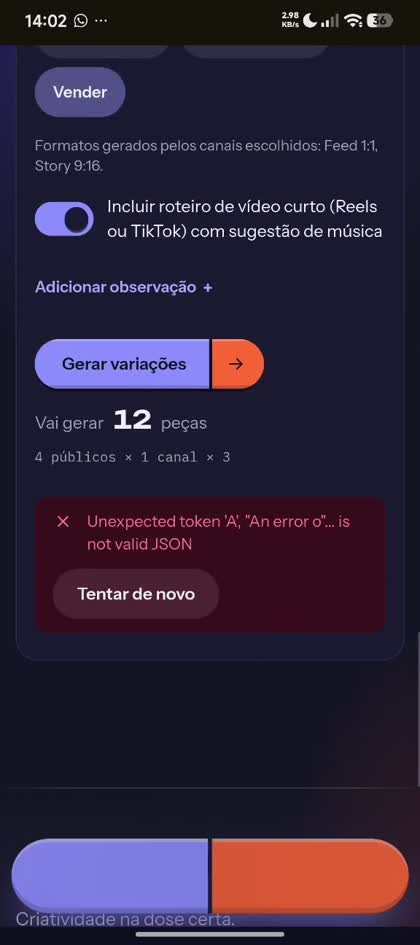
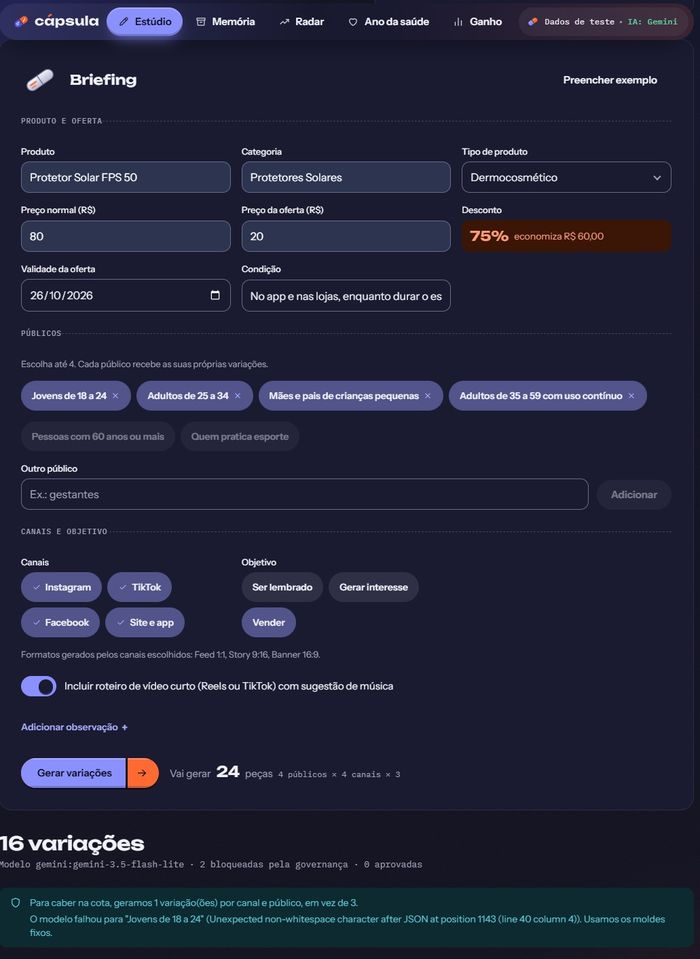
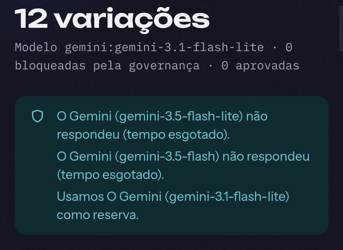

# QA em produção (I5, #83 e #14)

**URL:** https://capsula-mvp.vercel.app · **Checklist criado e executado em:** 22/10/2026 (por API e, depois, em tela no Chrome, no computador) · **Itens 1.3, 3.5 e 6.4 executados em:** 25/10/2026, com navegador automatizado (Playwright + Edge) na produção

Percurso completo: briefing → variações → Bula → governança → aprovação em 4 estados → Memória → painel de Ganho. Cada linha tem o estado da última execução. **API** = executado por chamadas às rotas da URL publicada. **Tela** = precisa de uma pessoa (ou do Chrome conectado) abrindo o site.

Legenda: ✅ passou · ⬜ ainda não executado · ❌ falhou (vira issue com passos e print).

## 1. Briefing

| # | Passo | Como | Estado |
|---|---|---|---|
| 1.1 | A tela do Estúdio abre e o botão "Preencher exemplo" preenche tudo | Tela | ✅ 22/10 |
| 1.2 | Briefing incompleto mostra quais campos faltam (produto vazio → erro no campo) | API (400 com `campos`) · Tela | ✅ API · ✅ Tela ("Informe o produto.", campo com `aria-invalid`) |
| 1.3 | Seletor de tipo de produto, públicos e canais funcionam com o teclado | Tela, só teclado (25/10) | ✅ Tab chega ao seletor; Enter abre, End vai à última opção e Enter escolhe ("Dermocosmético" → "Serviço da farmácia"), com o foco voltando ao botão. Espaço adiciona o público "Jovens de 18 a 24" e liga ou desliga o canal (aria-pressed muda). Os 16 elementos percorridos mostram o foco; no campo de data, o foco aparece no dia e no ícone do calendário |

## 2. Variações

| # | Passo | Como | Estado |
|---|---|---|---|
| 2.1 | "Gerar variações" devolve 3 peças por canal e público, com Bula | API | ✅ 22/10 |
| 2.2 | Aparece o modelo usado; se o Gemini falha, passa para os modelos de reserva e depois para os moldes fixos, sempre com aviso | API (reserva usada em produção em 22/10) | ✅ |
| 2.3 | Roteiros: Reels ou TikTok 15s, comercial 15s e 30s, com música liberada | API | ✅ |
| 2.4 | Peças nos três formatos (feed, story, banner) e "Baixar PNG" no tamanho real | Tela, em produção | ✅ 1080×1080, 1080×1920 e 1920×1080. **Achado:** com o navegador em modo escuro as peças saíam quase pretas (tema "sistema"); corrigido no PR #93 (padrão "claro") |

## 3. Bula e governança

| # | Passo | Como | Estado |
|---|---|---|---|
| 3.1 | A Bula tem as 5 seções, a dose vem do motor e cada evidência tem fonte | API | ✅ |
| 3.2 | Peça sem Bula, com Bula vazia ou sem evidências é recusada | API (400) | ✅ |
| 3.3 | Peça com promessa de cura fica bloqueada e não avança, com o motivo na Bula | API (409) | ✅ |
| 3.4 | Medicamento com prescrição bloqueia tudo; medicamento isento leva a advertência da Anvisa | API (ver `qa-motor.md`) | ✅ |
| 3.5 | Roteiro com texto proibido aparece como "bloqueado pelo checklist" | Testes automatizados · Tela (25/10) | ✅ testes · ✅ Tela: briefing de exemplo trocado para "Medicamento com prescrição" ("Antibiótico 500 mg"), gerado em 14,9 s. Resumo: "12 bloqueadas pela governança"; os 6 roteiros aparecem como "bloqueado pelo checklist", com o motivo da RDC 96/2008 ([captura](img/qa-roteiro-bloqueado.jpg)) |

## 4. Aprovação em 4 estados

| # | Passo | Como | Estado |
|---|---|---|---|
| 4.1 | Rascunho → em revisão → aprovado → publicado, com o nome de quem mudou | API (200 nos três passos) | ✅ |
| 4.2 | Sem o nome da pessoa, a mudança é recusada | API (409) | ✅ |
| 4.3 | Publicar sem aprovar é recusado | API (409) | ✅ |
| 4.4 | O carimbo "Aprovado"/"Publicado" aparece e o histórico lista quem mudou | Tela | ✅ Bula aberta, "Enviar para revisão" → "Aprovar" → "Publicar", carimbo PUBLICADO e 3 linhas de histórico com nome e hora |

## 5. Memória e Ganho

| # | Passo | Como | Estado |
|---|---|---|---|
| 5.1 | A tela da Memória carrega o ranking (melhores e piores combinações) com origem "sintético" | API (200) · Tela | ✅ API · ✅ Tela (300 campanhas, período 10/2025 a 09/2026) |
| 5.2 | A peça aprovada volta para a Memória | Tela | ✅ "Publicadas pelo Estúdio: 1 peça, aprovada por Teste QA" |
| 5.3 | O painel de Ganho abre e mostra os números | Tela | ✅ tempo por briefing, variações por briefing e peças barradas |
| 5.4 | Radar e Ano da saúde carregam; itens de exemplo aparecem marcados | API (200) · Tela | ✅ API · ✅ Tela (Radar com 16 itens marcados "dados de teste", música liberada e sem liberação; rodapé mostra a versão publicada) |

## 6. Computador e celular

| # | Passo | Como | Estado |
|---|---|---|---|
| 6.1 | Sem rolagem horizontal em 360, 768 e 1280px em nenhuma das 5 telas | Chrome (22/10) | ✅ |
| 6.2 | Barra de baixo no celular recolhe ao rolar; alvos de toque de 44px | Chrome (15/10) | ✅ |
| 6.3 | Tabela do Ano da saúde legível no celular depois do PR #73 | Chrome, tela de 390 px (iframe) | ✅ nome de 112 px, cabeçalho preso, meses legíveis. ⬜ aparelho real (o Ivaldo testou a tela de geração no celular em 26/10; ver abaixo) |
| 6.4 | Fluxo completo no celular | Emulação de iPhone 13 (390×844, toque), 25/10 · Aparelho real | ✅ emulação: "Preencher exemplo" → gerar (15,1 s) → Ver bula → nome → Enviar para revisão → Aprovar → Publicar, com o carimbo PUBLICADO ([captura](img/qa-celular-publicado.jpg)); a peça aparece na Memória em "Publicadas pelo Estúdio"; página com 390 px para tela de 390 px, sem rolagem lateral. Aparelho físico: o Ivaldo testou a geração e a galeria em 26/10 ([resultado abaixo](#teste-em-aparelho-físico-feito-pelo-ivaldo-2610)); a aprovação até "Publicar" em aparelho físico segue só por emulação |

## Teste em aparelho físico, feito pelo Ivaldo (26/10)

Em 26/10, o Ivaldo testou o sistema na produção, no celular e no computador, e enviou gravações e capturas de tela ao João. É o complemento que o [passo 6.4](#6-computador-e-celular) deixava em aberto (a execução de 25/10 foi por emulação). O teste usou a versão `2cac5dd`, a da época do envio, e achou três problemas. Os três foram corrigidos no mesmo dia, no PR #121.

| # | O que o Ivaldo viu | Evidência | Causa | Correção (PR #121) |
|---|---|---|---|---|
| 1 | No celular, o briefing de 4 públicos e 1 canal (12 peças) ficou cerca de 1 minuto com a tela de "Dosando 12 peças" e terminou em "Unexpected token 'A', "An error o"… is not valid JSON" |  | A função da Vercel passou do limite de 60 s e devolveu texto puro, não JSON. Os modelos demoraram para responder, e uma tentativa começada perto do limite não tinha tempo de acabar | Teto de 54 s contado desde o início: cada tentativa recebe só o tempo que resta. A tela mostra uma mensagem clara com "Tentar de novo" quando a resposta não é JSON |
| 2 | No computador, o modelo falhou para "Jovens de 18 a 24" com "Unexpected non-whitespace character after JSON at position 1143", e o sistema usou os moldes fixos nesse público |  | O modelo escreveu texto depois do objeto JSON, com outra chave `}`, e o leitor cortava até a última chave do texto | O leitor percorre as chaves, respeitando as aspas, e para onde o primeiro objeto fecha. Três testes novos cobrem o caso |
| 3 | O aviso saía como "Usamos **O** Gemini (…) como reserva", com o artigo em maiúscula no meio da frase |  | O mesmo texto servia para começo e meio de frase | O artigo vai em minúscula no meio da frase |

O teste também confirmou o que o sistema faz por projeto:

- **Reserva de modelo:** quando o `gemini-3.5-flash-lite` e o `gemini-3.5-flash` não responderam a tempo, o `gemini-3.1-flash-lite` assumiu, e a galeria mostrou as 12 variações com o aviso do que aconteceu.
- **Limite de cota:** com 3 públicos, 4 canais e 3 formatos, o sistema avisou "Para caber na cota, geramos 2 variação(ões) por canal e público, em vez de 3" e entregou 24 variações, uma delas bloqueada pela governança ([captura](img/qa-ivaldo-cota.jpg)).
- **Navegação no celular:** o menu inferior (Estúdio, Memória, Radar, Saúde, Ganho), o formulário e o botão de gerar funcionaram no aparelho dele.

Nas gravações do Ivaldo, o fluxo foi até a geração e a galeria. A aprovação até "Publicar" em aparelho físico não aparece nelas e continua conferida só por emulação. A espera pela geração depende do modelo e pode chegar a cerca de um minuto quando os modelos principais demoram; a [lista de limitações](limitacoes-e-proximos-passos.md) trata disso.

## Falhas registradas

Cinco falhas encontradas em tela e corrigidas no mesmo dia: três no teste do Ivaldo em aparelho físico (26/10, PR #121, descritas acima), peças pretas no navegador em modo escuro (PR #93, 22/10) e o id interno de uma evidência aparecendo na fala de um roteiro (PR #111, 25/10). Nenhuma outra falha de produto nas execuções por API e em tela. Os 24 passos foram executados, e o fluxo no celular teve também o teste do Ivaldo em aparelho físico (26/10). Novas falhas devem ser anotadas com data, passos e print.

Observação de risco já conhecida: o Gemini responde 503 ou 429 com alguma frequência no plano gratuito. O sistema avisa e usa reserva, mas o texto pode sair de molde fixo. Antes da banca, gerar uma vez no horário para o cache guardar uma resposta com IA.
